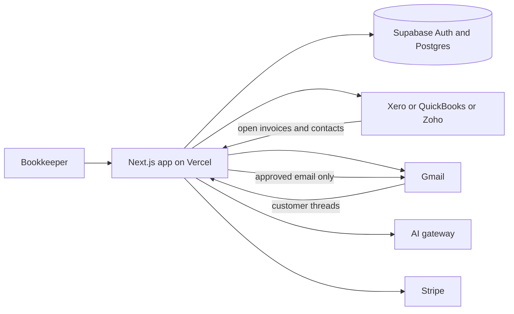
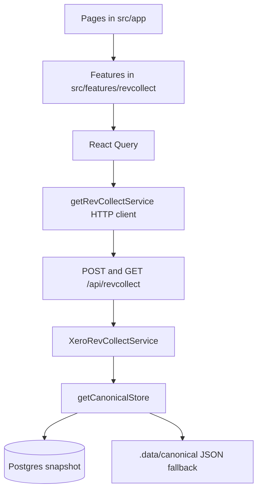
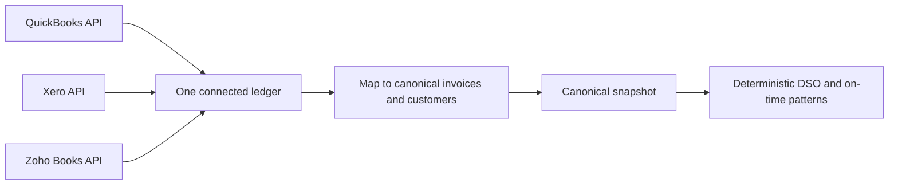
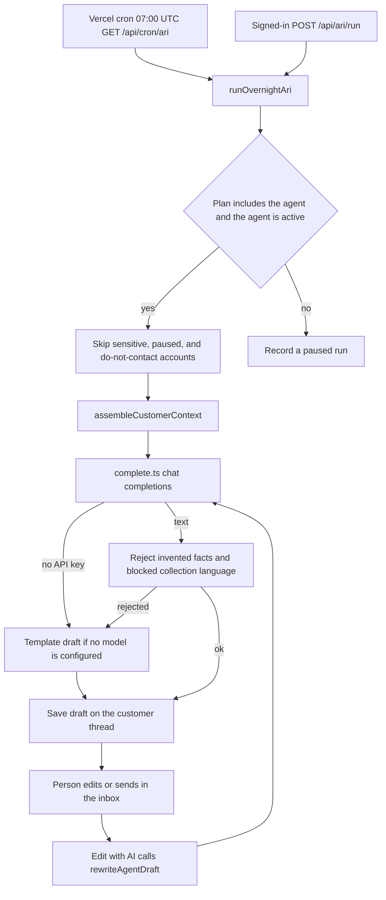
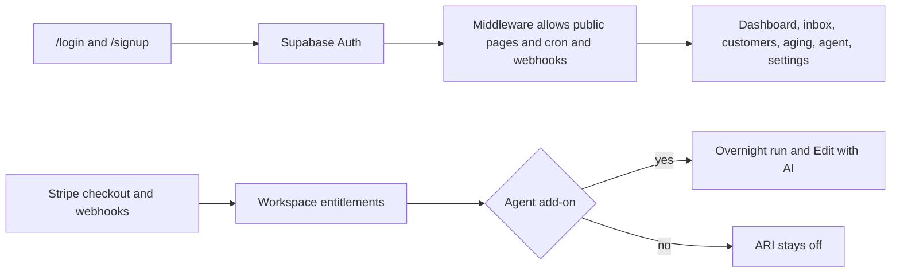

# RevCollect application architecture

How the running app is wired. A workspace connects one accounting ledger and Gmail. ARI drafts collection follow-ups. A person sends them.

Related: [data-layer-and-compliance.md](../data-layer-and-compliance.md) is the privacy contract. [context-intelligence-plan.md](./context-intelligence-plan.md) is a later design for a fact layer. This page is the system that is in the repo today.

## System

One tenant is one signed-in Supabase user. That tenant may have one books connection. Connecting a second ledger disconnects the first.

## Screens

Signed-in routes live under `src/app/(app)/`.

| Route | Job |
| --- | --- |
| `/dashboard` | Overnight ARI summary and cash picture |
| `/inbox` and `/inbox/[messageId]` | Thread, AI draft, send |
| `/customers` and `/customers/[id]` | Balances, relationship state |
| `/aging` | Open invoices by age |
| `/agent` | Tone, follow-up rules, when ARI runs |
| `/onboarding` | Connect a ledger, then Gmail |
| `/settings` | Integrations, billing, appearance |

Public pages are marketing, login, signup, privacy, terms, security, and the disconnect/help pages for each ledger.

## Request path

Browser UI does not talk to Xero, QuickBooks, Zoho, or Gmail. It calls the BFF. The server reads and writes the canonical snapshot.

`src/features/revcollect/api/service.ts` is the contract. The browser uses `http-xero-service.ts`. Route handlers use `xero-service.ts`, which is server-only. If Supabase admin credentials are missing, or the Postgres store cannot be reached, the snapshot is a JSON file on disk.

The snapshot holds customers, invoices, payments, per-customer intelligence, ARI drafts, sent mail, agent config, and workspace settings.

## Ledger ingest

QuickBooks can also push webhooks. Xero and Zoho are pulled on read when the snapshot is empty or stale. Secrets for each OAuth connection stay in `integration_secrets`, service role only.

Switching ledgers clears the inbox that belonged to the previous books connection.

## Mail

Gmail sync attaches threads to open-balance customers by email address, then by subject when the address is ambiguous. Bodies used by the live inbox are stored on the tenant snapshot, not as a separate encrypted email table.

Sending is a button in the inbox. The server checks do-not-contact and the relationship state, appends the CAN-SPAM footer, and sends through the Gmail API. ARI never calls that path.

## ARI

ARI is the collections agent. It queues drafts. It does not send email, and it does not invent invoice numbers, amounts, dates, or names.

The model call goes to the Vercel AI gateway when `AI_GATEWAY_API_KEY` is set, otherwise to `AI_BASE_URL` with `AI_API_KEY`. Tasks are `generate`, `extract`, and `classify`.

On the way in, customer replies can be classified and a promised pay date can be extracted. That updates relationship state. It does not send a reply.

A logged-in force run is `POST /api/ari/run`. The daily cron uses `CRON_SECRET`.

## Auth and billing

Write actions and ARI both check entitlements. A workspace without the agent add-on cannot run the overnight loop or rewrite a draft. `autoSendEnabled` is stored as false.

## Outside this picture

- `agent/` is an optional Eve tool mirror of the same overnight loop. Production cron calls the TypeScript in `src/lib/ari/`.
- The compliance document still names Clerk and ciphertext `thread_emails`. Sign-in is Supabase. Live Gmail bodies sit on the tenant snapshot.
- Context intelligence snapshots, observation tables, and a separate extraction service are specified in the plan and are not built yet.
