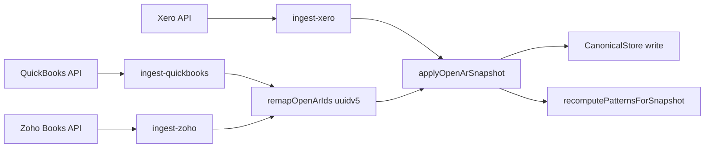
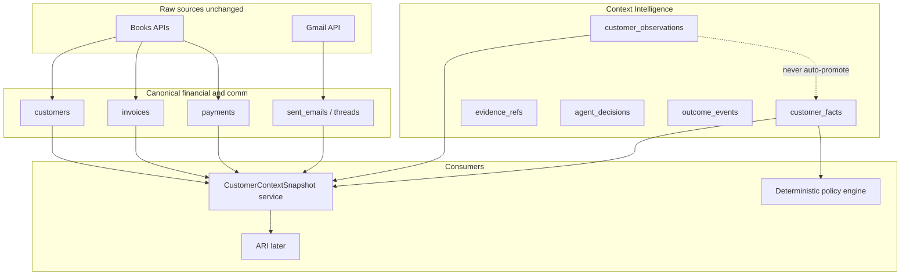
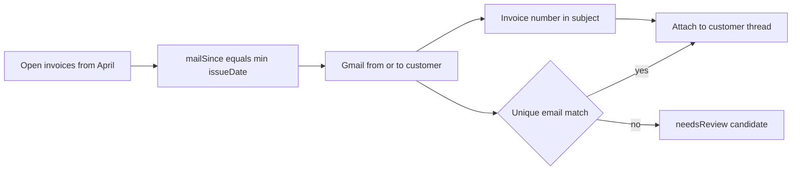

# Context Intelligence Foundation — Audit and Implementation Plan

Audit-backed architecture plan for a model-independent Context Intelligence Layer on top of the existing canonical AR + Gmail stack.

**Status:** Plan approved for documentation. **Do not** add migrations, change production schemas, or install dependencies until a separate implementation approval.

**Objective:** Make RevCollect understand a customer's financial and communication history in a persistent, explainable, model-independent way. ARI will consume this intelligence later. Intelligence lives in RevCollect's data, not in the LLM.

---

## 1. Current architecture inventory (verified)

### Stack

| Layer | What exists |
| --- | --- |
| App | Next.js 16 App Router, TypeScript, Vercel |
| Auth | Supabase Auth (`auth.uid()` = tenant id today); docs still mention Clerk org mapping as future |
| DB | Supabase Postgres — migrations in [`supabase/migrations/`](../../supabase/migrations/) |
| ORM | None — `@supabase/supabase-js` service-role client [`src/lib/supabase/admin.ts`](../../src/lib/supabase/admin.ts) |
| Canonical AR | [`src/lib/canonical/`](../../src/lib/canonical/) — Postgres store or `.data/canonical/*.json` fallback |
| Queues | No Redis/Bull — in-process Maps + `after()` + Vercel Cron |
| Cron | [`vercel.json`](../../vercel.json): `/api/cron/ari`, `/api/cron/supabase-keepalive` |

### Core tables (migrations)

- **Financial:** `tenants`, `customers`, `invoices`, `payments` (unique `tenant_id, external_id`)
- **Comm (schema):** `inbox_threads`, `thread_emails` (ciphertext), `email_attachments`, `timeline_events`
- **Agent:** `agent_drafts`, `agent_config`, `ari_runs`
- **Secrets:** `integration_secrets` (service-role only)
- **Compliance:** `audit_log`, export/deletion request tables + [`20260615000003_compliance_functions.sql`](../../supabase/migrations/20260615000003_compliance_functions.sql)

**Runtime reality:** Gmail bodies live primarily in `tenants.sent_emails` JSONB ([`postgres-store.ts`](../../src/lib/canonical/postgres-store.ts)); `inbox_threads` is upserted lightly; `thread_emails` ciphertext path is largely unused by the live sync path ([`sync-gmail.ts`](../../src/lib/canonical/sync-gmail.ts)).

### Ledger normalization



- Router: [`ingest-accounting.ts`](../../src/lib/canonical/ingest-accounting.ts)
- Mappers: [`xero-map.ts`](../../src/features/revcollect/api/xero-map.ts) (shared)
- One books ledger per tenant: [`books-exclusivity.ts`](../../src/lib/integrations/books-exclusivity.ts)
- QBO webhooks only; Xero/Zoho are pull/resync

### Gmail and identity

- Sync: [`sync-gmail.ts`](../../src/lib/canonical/sync-gmail.ts) — thread ownership, `from:` by customer email, subject fallback
- Rehome: [`sent-emails.ts`](../../src/lib/canonical/sent-emails.ts) — exact email among open-balance customers; ambiguous → subject/company heuristic
- Ledger switch clears mail: [`clear-inbox-for-ledger-switch.ts`](../../src/lib/canonical/clear-inbox-for-ledger-switch.ts)
- **No** cross-ledger global customer graph

### Existing “intelligence” (embedded, not first-class facts)

[`CustomerIntelligence`](../../src/lib/canonical/types.ts) in `customers.intelligence` JSONB:

- Type 2 **patterns** — deterministic DSO/on-time/trend ([`patterns.ts`](../../src/lib/canonical/patterns.ts))
- Type 3 **situations** — expiring flags + evidence string ([`extract-situation.ts`](../../src/features/revcollect/extract/extract-situation.ts))
- Type 4 **preferences** — greeting/signoff from draft edits
- **relationship_state** / **relationship_policy** columns + [`relationship-policy.ts`](../../src/features/revcollect/lib/relationship-policy.ts)
- **promised_date** + auto-promises ([`apply-auto-promises.ts`](../../src/lib/ari/apply-auto-promises.ts))

Prompt assembler today: [`assemble-context.ts`](../../src/features/revcollect/context/assemble-context.ts) → prompt string + `DraftFacts` for validators — **not** a structured snapshot API.

### AI / ARI

- Overnight: [`run-overnight.ts`](../../src/lib/ari/run-overnight.ts) (never auto-sends)
- Classify/promise: [`classify.ts`](../../src/lib/ari/classify.ts), [`parse-promise-date.ts`](../../src/lib/ari/parse-promise-date.ts)
- LLM gateway: [`complete.ts`](../../src/lib/ai/complete.ts)
- Eve tools parallel path under [`agent/`](../../agent/) — optional; production cron is TypeScript
- **No JEV** in repo; risk bands are UI thresholds only

### Isolation, tests, audit

- RLS SQL exists ([`20260615000002_rls_policies.sql`](../../supabase/migrations/20260615000002_rls_policies.sql)) but app uses **service role** + `.eq('tenant_id', …)` — `app.tenant_id` is never set in `src/`
- Automated unit/integration tests: **none** (only [`evals/entity-fidelity.ts`](../../evals/entity-fidelity.ts))

---

## 2. Capability matrix

| Capability | Status |
| --- | --- |
| **A. Canonical customers/invoices/payments/balances** | Present |
| Source-system IDs / external_id | Present (partial provenance) |
| Partial payments | Present (`paid_cents`, `amount_due_cents`, payments rows) |
| Credits / disputes as ledger entities | Partial — dispute is collection/relationship state, not credit-note ledger model for all providers |
| Idempotent sync + historical change log | Partial — upsert by id/external_id; **no** append-only ledger changelog |
| Safe non-merge of different customers | Partial — exclusivity + uuid remap; **no** merge graph; email collision risk |
| **B. Gmail thread/message association** | Present (heuristic) |
| Roles, invoice refs in thread, internal vs external | Partial / missing |
| Promises / promised dates | Present |
| Disputes, payment claims, hardship, restrictions | Partial — relationship states + situations; not evidence-normalized facts |
| Uncertain match flagged not attached | **Missing** — heuristics attach; ledger switch clears rather than uncertain queue |
| Historical mail for open invoices (pre-connect follow-ups) | **Missing** — sync window is `booksConnectedAt`, so April invoices + manual chase before launch are dropped |
| **C. Persistent customer intelligence** | Partial — JSONB patterns/situations |
| Fact vs observation, confidence, supersession, validity | **Missing** as first-class tables |
| Follow-up effectiveness metrics | **Missing** |
| **D. Explainability** | Partial — situations have evidence string; decisions not fact-linked |
| Model/prompt/schema/policy versions on decisions | **Missing** |
| User correction of observations | **Missing** |
| Auditable historical evidence | Partial — `audit_log` schema; not wired to intelligence |

---

## 3. Proposed data flow and schema changes

### Principle

**Do not duplicate** `customers` / `invoices` / `payments`. Add thin intelligence tables beside them. Keep `customers.intelligence` as a **read-model cache** fed from verified facts + deterministic patterns so ARI/UI keep working.



### New tables (additive migrations — implement later)

1. **`evidence_refs`** — `tenant_id`, `kind` (`invoice`|`payment`|`email_message`|`thread`|`manual`), `source_id`, optional `span`/`quote`, `captured_at`
2. **`customer_observations`** — untrusted extracts: `type`, `value` jsonb, `confidence`, `status` (`proposed`|`rejected`|`superseded`), `evidence_id`, `extractor_version`, `model_id` nullable, `observed_at`, `expires_at`, `superseded_by`
3. **`customer_facts`** — verified only: same shape + `verification` (`user`|`deterministic_rule`|`ledger_reconciled`), `effective_from`/`effective_to`, **never** written by LLM alone
4. **`customer_match_candidates`** — Gmail↔customer links with `confidence` and `review_status` (`auto_accepted`|`needs_review`|`rejected`) — uncertain matches land here instead of silent attach
5. **`agent_decisions`** — decision type, input fact ids, rule/policy version, optional model/prompt versions, outcome link
6. **`outcome_events`** — payment received, promise kept/broken, reply received, user override

### Column adds (minimal)

- `customers.source_provider`, `customers.source_external_id` (if not already covered by `external_id` + tenant books provider)
- `invoices.source_provider` similarly
- Optional `tenants.books_last_synced_at` already as `last_synced_at` — expose in snapshot freshness

### Launch scenario: open invoices + prior manual follow-ups

**Problem (product):** A tenant launches RevCollect tomorrow with unpaid invoices from April and has already emailed customers manually for months. Today that history is **not** captured: Gmail sync uses [`getBooksConnectedAt`](../../src/lib/integrations/books-connected-at.ts) as `mailSince`, so anything before connect is filtered out even though open AR still includes those April invoices.

**What must be captured:** For each open-AR customer with a usable email, pull Gmail that evidences the collections conversation for those invoices — including:

1. Manual follow-ups the user already sent/received (primary case for launch).
2. Invoice-delivery emails **if** they landed in the connected Gmail (send-from-my-email / copies in Sent). Ledger-server-sent mail that never touched Gmail cannot be recovered from Gmail; those stay as a `gaps[]` item (optional synthetic “invoice issued” stub is a later enhancement, not required for launch history).

**Chosen backfill rule (to implement after approval):**

- Replace the global `booksConnectedAt` floor for **open-AR customers** with per-customer  
  `mailSince = min(issueDate of that customer’s open invoices)` (fallback: oldest open invoice due date if issue missing).
- Cap lookback (default **365 days**) so one ancient unpaid invoice does not pull years of unrelated mail.
- Query Gmail with customer email (`from:` / `to:`) in that window; boost confidence when subject/body contains an open invoice number.
- Exact unique email match → attach to customer thread; ambiguous → `customer_match_candidates` / `needsReview` (never silent wrong attach).
- Customers with no usable email: inbox stays empty; snapshot lists gap `missing_customer_email`.
- Paid-only / zero-balance customers: keep current connect-time window (or skip historical backfill) to limit API cost.



This sits in implementation sequence as **Slice 2a** (historical open-AR Gmail backfill), alongside match honesty (Slice 2).

#### How to solve it (concrete)

| Step | Change |
| --- | --- |
| 1 | Add `openArMailSince(customer, invoices): string \| null` — `min(issueDate)` of that customer’s open invoices, floored to now−365d. |
| 2 | In [`sync-gmail.ts`](../../src/lib/canonical/sync-gmail.ts), stop using a single tenant `mailSince = getBooksConnectedAt` for open-AR customers. Per customer: use `openArMailSince`; for everyone else keep connect-time (or skip). |
| 3 | Pass that per-customer since into [`searchGmailFromAddress`](../../src/lib/integrations/gmail-api.ts) / `filterEmailsSince` so April→today mail for that address is fetched. |
| 4 | When attaching, if multiple open-AR customers share the same email → do **not** auto-attach; mark `needsReview` (Slice 2). Unique email → attach to that customer’s `xero-customer-{id}` thread. |
| 5 | Optional boost: if message subject/body contains an open invoice `number`, treat as stronger evidence (still require unique email or needsReview). |
| 6 | Snapshot / inbox: customers with open AR + usable email but zero matched messages get `gaps: ['no_gmail_history_in_window']` (invoice may have been emailed outside Gmail). |
| 7 | Do **not** clear historical mail on every books reconnect if the same ledger reconnects; only clear on **ledger switch** (existing [`clear-inbox-for-ledger-switch`](../../src/lib/canonical/clear-inbox-for-ledger-switch.ts)). |

**Result for launch:** connect Zoho/QBO/Xero + Gmail tomorrow → open April invoices ingest as today → Gmail sync pulls your existing chase emails with those customers into each customer inbox (when the mail is in that Gmail and the email matches uniquely).

**Out of scope for this fix:** reconstructing bodies of ledger-server invoice emails that never entered Gmail; cross-mailbox import; scraping PDF invoice sends.

### Snapshot service (vertical slice target)

New module e.g. [`src/lib/context-intelligence/build-customer-snapshot.ts`](../../src/lib/context-intelligence/build-customer-snapshot.ts):

`buildCustomerContextSnapshot(tenantId, customerId) → CustomerContextSnapshot`

Includes: identity, open invoices/balances, payment history, deterministic behavior metrics (reuse [`patterns.ts`](../../src/lib/canonical/patterns.ts)), associated communications **only** when match confidence ≥ threshold else `needsReview`, verified promises/restrictions from facts/relationship_policy, blockers, provenance + `generatedAt`, `gaps[]` / `contradictions[]`.

Internal API: `GET /api/internal/context/customers/[customerId]` (cron/session auth, tenant-scoped) — read-only.

`assembleCustomerContext` later becomes a thin prompt formatter over this snapshot (not in slice 1).

### AI extraction (design only — Phase 5)

```ts
extractCommunicationSignals(message, context): Promise<ExtractionResult>
// structured Zod schema; evidence spans; uncertainty; no send permission
```

Potential signals: payment promise, dispute, payment already claimed, financial hardship, sensitive event, contact restriction, AP contact change, request for documentation, uncertain/ambiguous intent.

Provider-agnostic behind [`complete.ts`](../../src/lib/ai/complete.ts). Outputs → `customer_observations` only. Policy engine (existing [`relationship-policy.ts`](../../src/features/revcollect/lib/relationship-policy.ts) + future rules) decides sendability.

The LLM must not decide whether a collection email can be sent. That belongs to a separate deterministic policy engine.

---

## 4. Implementation sequence (after separate build approval)

1. **Write** this document (`docs/architecture/context-intelligence-plan.md`) — done when landed in repo.
2. **Slice 0 — types + pure builders:** `CustomerContextSnapshot` types; `buildCustomerContextSnapshot` reading existing canonical store only (no new tables); gap/contradiction heuristics; Vitest fixtures.
3. **Slice 1 — API:** internal GET route + tenant isolation tests.
4. **Slice 2 — match honesty:** introduce `customer_match_candidates` OR in-memory flag on snapshot when email match is ambiguous; stop silent wrong attach for low confidence.
5. **Slice 2a — historical open-AR Gmail backfill:** per-customer `mailSince` from oldest open invoice `issueDate` (365-day cap); attach manual follow-ups + any invoice emails present in Gmail; flag gaps when mail never hit Gmail.
6. **Slice 3 — observations/facts tables** + dual-write from existing situation/promise/relationship paths (LLM → observation; user/rule → fact).
7. **Slice 4 — decisions/outcomes** wired from ARI draft queue and payment ingest (append-only).
8. **Slice 5 — extraction interface** + golden fixtures (no production autonomous send).
9. **Hardening:** wire `audit_log` for fact corrections; schedule situation sweeper; document RLS service-role caveat.

---

## 5. Risks, assumptions, unresolved decisions

| Item | Stance |
| --- | --- |
| Tenant = `auth.uid()` until org mapping | Assumed; snapshot API must use same resolver as [`tenant.ts`](../../src/lib/integrations/tenant.ts) |
| Service-role bypasses RLS | Accepted short-term; all queries must filter `tenant_id`; long-term SET LOCAL or user-scoped client |
| `sent_emails` JSONB vs `thread_emails` | Slice 0–1 read JSONB; migrating bodies to ciphertext tables is a **separate** compliance project |
| Books exclusivity | No multi-ledger merge in v1; identity graph deferred |
| Weekly Supabase keepalive vs “activity over the week” | Unrelated ops risk; not part of this layer |
| Match confidence threshold | Default **0.8 exact email unique**; else `needs_review` — tune later |
| Historical backfill window | Per open-AR customer: `min(open invoice issueDate)`, capped at 365 days |
| Ledger-only invoice emails not in Gmail | Recorded as snapshot `gaps[]`; no fabricated body |
| Whether to expose snapshot in UI | Internal/API first; UI later |

---

## 6. Complexity and dependencies

| Work | Size | Depends on |
| --- | --- | --- |
| Architecture doc | S | — |
| Snapshot builder on existing store | M | canonical types, patterns |
| Vitest harness + fixtures | M | package.json test script (new) |
| Internal API | S | snapshot builder, auth |
| Observations/facts migrations | M | approval to touch DB |
| Match candidates + sync-gmail changes | M | careful not to break inbox |
| Extraction interface + evals | M | complete.ts, Zod |
| Decisions/outcomes | M | ARI + ingest hooks |

**Out of scope / forbidden:** LangGraph, vector DB for facts, fine-tuning, chatbot, autonomous send, AI writing financial SoT, rewriting QBO/Xero/Zoho/Gmail OAuth.

---

## 7. Acceptance criteria — first vertical slice

Given tenant T and customer C that exist in the canonical store:

1. `buildCustomerContextSnapshot(T, C)` returns structured JSON with identity, open invoices, payments, pattern metrics, freshness (`ingestedAt`), and `generatedAt`.
2. Communications included only with evidence-backed association; ambiguous Gmail links appear under `needsReview` / omitted from attached history — **never** silently wrong-customer.
3. Missing fields listed in `gaps[]`; ledger vs promise contradictions in `contradictions[]` — no fabricated values.
4. Verified promises/restrictions reflected from existing `promisedDate` / `relationship_policy` when present.
5. Calling twice yields stable financial fields (idempotent read); timestamps may differ.
6. Request for wrong tenant’s customer id returns null/404 — isolation test passes.
7. No LLM call required for snapshot generation.
8. No migration required for slice 0–1; existing APIs unchanged.

---

## Gate

This document is the audit and implementation plan only.

**Next:** explicit approval to begin Slice 0 (types + snapshot builder + Vitest). Until then: no migrations, no production code changes, no new dependencies.
