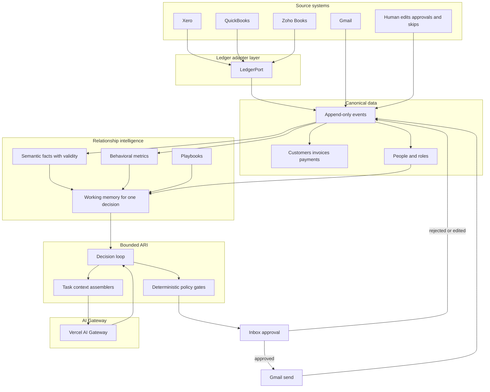
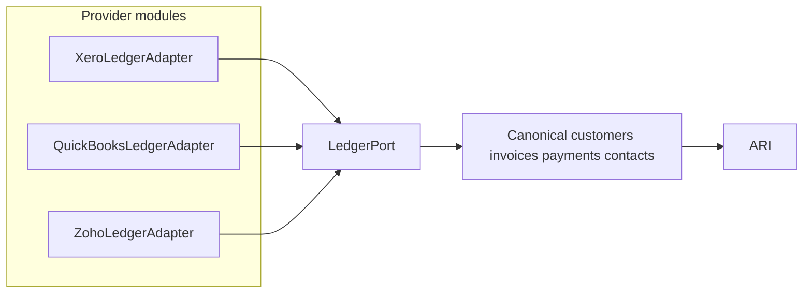
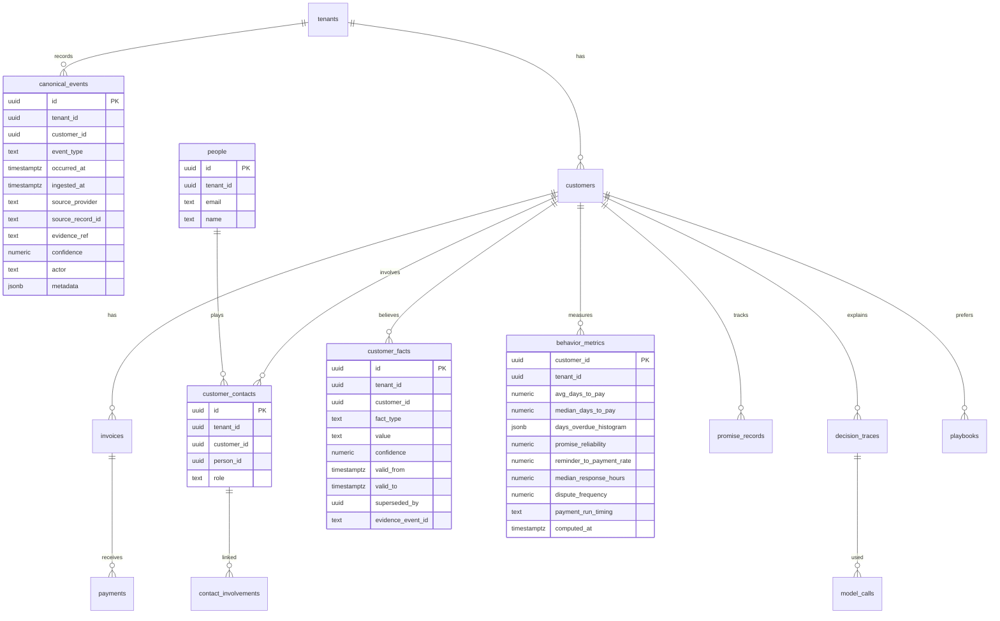
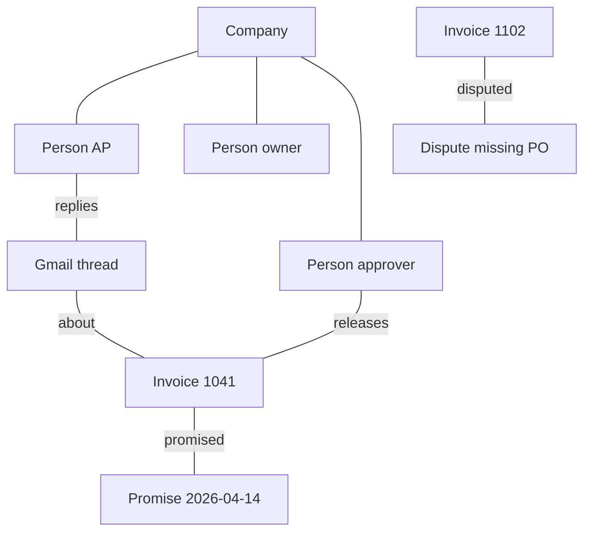
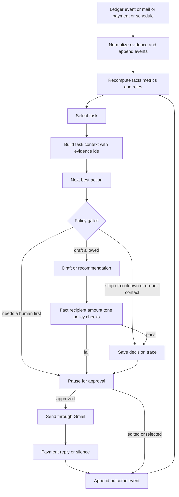
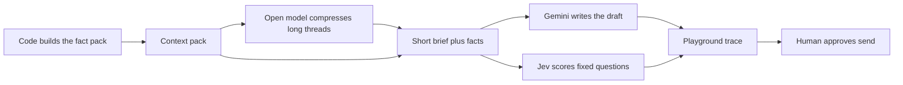
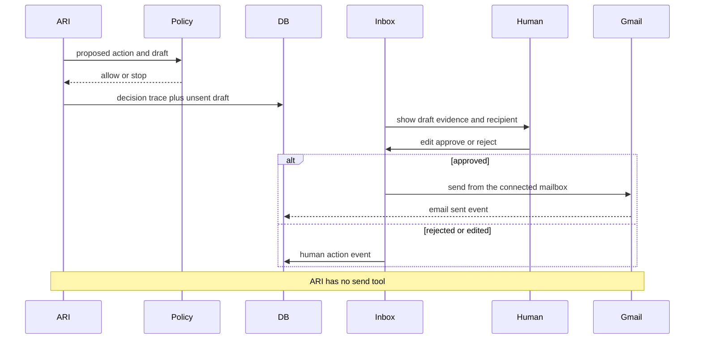
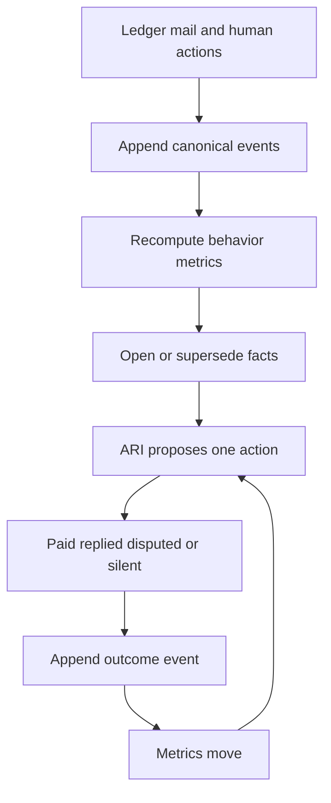

# ARI architecture

Target architecture for RevCollect’s customer-intelligence moat. This describes the system to build. It is not a claim that the target already runs.

Verified against the code on 3 November 2026. The live model list was read from `https://ai-gateway.vercel.sh/v1/models` (497 models). Installed AI SDK is `ai@7.0.83`. That package does not export `experimental_evaluate`.

What runs today is a snapshot store plus an overnight draft loop. See [Current system](#current-system-verified). The diagrams below are the next-generation design. Phase 2 does not start until the plan in [ari-implementation-plan.md](./ari-implementation-plan.md) is approved.

## Moat

RevCollect’s advantage is a time-aware record of how each company pays and who is involved, not a better email writer.

ARI reads that record, proposes one next action, and stops. A person sends the email. Customer data is never used to train or fine-tune a model.

## 1. Full system



Layers:

| Layer | Responsibility | Must not do |
| --- | --- | --- |
| Source systems | Emit raw ledger, mail, and human actions | Decide collection policy |
| Ledger adapters | Normalize one provider into canonical customers, invoices, and payments | Leak provider types into ARI |
| Event layer | Append what happened, with evidence | Update history in place |
| Intelligence | Queryable facts, metrics, people, and playbooks | Store the whole model as one JSON blob |
| Context assemblers | Build the smallest evidence pack for one task | Send the full history on every call |
| ARI | Choose one next action inside hard gates | Send email or invent invoice facts |
| AI Gateway | Run inference with a catalog model id | Train on customer data |
| Inbox | Human approval | Auto-send |

## 2. Ledger adapters

ARI sees `Customer`, `Invoice`, `Payment`, and `Contact`. It does not see a Xero invoice, a QuickBooks invoice, or a Zoho invoice.



Proposed port. Names match the job, not a provider SDK.

```ts
interface LedgerCapabilities {
  customers: boolean
  invoices: boolean
  payments: boolean
  creditNotes: boolean
  webhooks: boolean
  invoicePdf: boolean
}

interface LedgerPort {
  connect(tenantId: string): Promise<void>
  disconnect(tenantId: string): Promise<void>
  getCapabilities(): LedgerCapabilities
  syncCustomers(tenantId: string): Promise<CanonicalCustomer[]>
  syncInvoices(tenantId: string): Promise<CanonicalInvoice[]>
  syncPayments(tenantId: string): Promise<CanonicalPayment[]>
  syncAccountsReceivable(tenantId: string): Promise<CanonicalReceivableSnapshot>
}
```

Rules:

- One connected ledger per tenant. This already exists in `books-exclusivity.ts`.
- Provider ids stay on the event as `sourceProvider` and `sourceRecordId`. They are provenance, not business logic.
- A provider that cannot supply payments says so in `getCapabilities()`. Metrics that need payments are marked gap, not guessed.
- QuickBooks and Zoho stay behind adapters. Support is claimed only after an end-to-end test for that provider passes.

Today the three ingest functions (`ingest-xero.ts`, `ingest-quickbooks.ts`, `ingest-zoho.ts`) already write one `CanonicalSnapshot` through `applyOpenArSnapshot`. They are not a `LedgerPort`. QuickBooks and Zoho reuse mappers in `xero-map.ts`. There is no automated test that a Xero, QuickBooks, or Zoho payload becomes the same canonical shape.

## 3. Canonical intelligence model

Important facts and metrics are columns or their own tables. JSONB is only for extra metadata that is not queried.



`role` is one of `ap`, `finance`, `owner`, `approver`, `responder`, `unknown`. A person can hold more than one role over time. Role changes are events, not silent overwrites. Jev may write a current role when its confidence is high. The row keeps confidence, evidence, and source so a human or a newer observation can supersede it.

`customers.intelligence` JSONB exists today and holds patterns, situations, preferences, and relationship policy. Phase 2 keeps it as a read model fed from the tables above so the current inbox does not break. New queries go to the tables.

## 4. Temporal relationship graph

People, invoices, and messages are nodes. Edges are dated. A later observation can supersede an earlier one. It does not erase it.



Each edge stores `valid_from`, `valid_to`, `evidence_event_id`, and `confidence`. Contradictions stay as two facts with overlapping validity until a human or a newer high-confidence event sets `valid_to` on the loser and points `superseded_by` at the winner.

Example: a reply says “Alex approves payments” and a later reply says “Alex left; Priya approves.” Both facts remain. Only Priya is valid after the second event.

## 5. ARI decision loop

ARI is one orchestrator. Specialized steps are deterministic modules. There is no second agent.



Next actions are a closed set:

- `draft_follow_up`
- `draft_promise_check`
- `draft_payment_verification`
- `wait_for_promise`
- `skip`
- `escalate_human`
- `do_not_contact`

The model may recommend one of these. Policy may override it. The model may not add a new action and may not send.

Bounds, all enforced in code before any model call that would draft:

| Guard | Rule |
| --- | --- |
| Max attempts | A customer gets at most N drafts per invoice per 30 days. N comes from agent config. |
| Cooldown | No new draft inside the configured gap after a send. |
| Stop | Paid in full, zero balance, or no open invoice ends the loop. |
| Do-not-contact | `do_not_contact` and the blocked-address list skip drafting. |
| Sensitive and paused | `sensitive_event`, `paused_until_date`, `active_dispute`, `manual_only` do not get an automatic draft. |
| Idempotency | The same trigger event id cannot queue two drafts. |
| Retries | Model and provider retries are capped. A failed model call does not send. |
| Escalation | Broken promises, disputes, and verifier failures become a human task, not a firmer email. |
| No auto-send | `autoSendEnabled` stays false. The send function is not a tool ARI can call. |
| No invented facts | Drafts that cite an invoice number, amount, or date outside the context are discarded. |
| No duplicate outreach | An unsent draft for the same customer and invoice is updated, not copied. |

Triggers to add, beyond the existing daily cron:

- Invoice became overdue
- Payment received
- Customer reply ingested
- Promise date reached
- Scheduled review at `digestHour`

The cron remains a backstop so a missed event still gets a review.

## 6. Model path

Drafts do not go through Vercel AI Gateway, OpenAI, or Anthropic. The keys in use are `GEMINI_API_KEY` and the TypeSafe key for Jev. Browser code never sees either key. Invoice reading and the audit narrative already call Gemini at `generativelanguage.googleapis.com`. ARI uses that same key.



| Step | Who | What it is allowed to do |
| --- | --- | --- |
| Fact pack | Application code | Invoice numbers, amounts, dates, roles, and policy gates. This is the source of truth and costs nothing. |
| Brief | A small open-weights model, only when the thread is long | Compress mail into a short brief. It cannot add an invoice, amount, or date. If it is not running, Gemini receives the fact pack as the code wrote it. |
| Draft | Gemini, `GEMINI_MODEL` or `gemini-flash-latest` | Write the email from the brief and the fact pack. |
| Why | Jev, pinned `jev-1.14.0` | Answer a fixed list of questions with a choice and a probability. It does not write the email and it does not train on customer mail. |

Jev is the explanation. Each question is visible in the product, for example “Is this a dispute?”, “Is the promise date usable?”, “Should a human take this?”. The playground shows the question, the score, and the fact ids that were in the pack. A later run can compare those scores with what the customer actually did. That comparison is how a playbook changes. It is not fine-tuning.

`/playground` is a signed-in page. One row is one decision: fact pack, brief, Gemini draft, Jev scores, and the policy gate. A person can rerun that customer and, after reading the trace, save a prompt or playbook change. Nothing on that page sends email.

Customer email text is untrusted. It cannot select the recipient or turn off a gate. Policy gates run in code after the models return. A failed Jev call uses the existing deterministic heuristic and lowers confidence. A failed Gemini call keeps the template draft.

## 7. Human approval and sending



The send path that exists today is `sendInboxFollowUp` in `xero-service.ts`. It checks the address, the do-not-contact list, and then calls Gmail. ARI’s queue function never calls it. That split stays.

Approval records store who approved, when, the draft hash they saw, and whether they edited the body. An edit is a learning event. It is not training data for a model.

## 8. Ingestion and learning



Learning means updating RevCollect’s own tables. It does not mean fine-tuning, preference-tuning, or sending thumbs-up data to a provider.

Metrics computed from events, not from a model:

- Average days to pay, from issue date to payment date
- Median days to pay
- Histogram of days overdue at payment
- Promise reliability, honored promises divided by promises that came due
- Reminder-to-payment conversion, payments within a window after a sent reminder
- Response latency, hours from send to the next customer reply
- Dispute frequency, disputes per paid or closed invoice
- Payment-run timing, the weekday or month-day cluster of historical payments

A metric with too few observations is stored as unknown. The draft context says “unknown” rather than a rounded zero that looks like a fact.

## Memory

| Memory | Holds | Lifetime | Example |
| --- | --- | --- | --- |
| Working | The pack for this decision | One run | Open invoices, last reply, active facts, metric snapshot, evidence ids |
| Episodic | Individual events | Retained with the tenant | “Email received 2 Apr”, “Promise made 4 Apr” |
| Semantic | Durable facts with validity | Until superseded or deleted | “Priya is the approver since 1 Mar” |
| Behavioral | Calculated patterns | Recomputed when events arrive | Median days to pay is 41 |
| Procedural | Playbooks that have evidence | Versioned | “For this company, a short note on Tuesday converts; Friday does not” |

Procedural memory starts empty. A playbook is written only after enough outcome events support it. Until then ARI uses the workspace tone and the deterministic policy.

## Context assemblers

One assembler per task. Each returns a structure plus the evidence event ids and timestamps the conclusion depends on. None of them attach the full thread history.

| Function | Includes | Excludes |
| --- | --- | --- |
| `buildDraftContext` | Open invoice facts, recipient and role, last customer turn, tone, active restrictions | Old paid invoices, unrelated threads |
| `buildNextBestActionContext` | Metrics summary, promise and dispute state, last action, cooldown | Draft prose, full mailbox |
| `buildEscalationContext` | Why the gate fired, evidence quotes, suggested owner | A ready-to-send demand |
| `buildReplyClassificationContext` | The new reply text as untrusted data, open invoice ids | Prior drafts, other customers |
| `buildPromiseEvaluationContext` | The promise event, due date, payments since | Unrelated disputes |
| `buildCustomerSummaryContext` | Valid facts, metrics, current roles | Raw email bodies |

`assembleCustomerContext` in `src/features/revcollect/context/assemble-context.ts` is the seed of `buildDraftContext`. It already refuses invented numbers by pairing a prompt with `DraftFacts`. The other five assemblers do not exist.

## Current system, verified

| Area | In code today |
| --- | --- |
| Ledger ingest | `ingestXeroAr`, `ingestQuickBooksAr`, `ingestZohoAr` write one snapshot. One ledger at a time. |
| Canonical shape | Customers, invoices, payments, one email on the customer, relationship state, intelligence JSON. |
| Patterns | `patterns.ts` computes average DSO, on-time rate, and a three-way trend. |
| Mail | Gmail sync and human send. Sent bodies live in `tenants.sent_emails` JSONB. |
| ARI | Overnight loop, template fallback, fact validator, reply heuristics, promise-date parse, relationship gates. |
| Rewrite | Uncommitted. `src/lib/ari/rewrite-draft.ts` rewrites an existing draft and still does not send. |
| Models | Raw `fetch` in `src/lib/ai/complete.ts`. AI SDK is installed and unused. |
| Tests | No project test suite. `evals/entity-fidelity.ts` checks the fact validator against a small JSON file. |
| People, events, decision traces, task assemblers, Jev | Not built |

`docs/data-layer-and-compliance.md` still describes Clerk and ciphertext `thread_emails`. Sign-in is Supabase. Those ciphertext rows are not what the live inbox reads. `docs/architecture/context-intelligence-plan.md` is an earlier design and is not this architecture.

## Privacy

- Inference only. No training flag, no fine-tune job, no dataset export to a provider.
- Application logs may store tenant id, event id, model id, token counts, latency, and status.
- Application logs may not store prompts, email bodies, or customer names.
- Gateway dashboard logs are outside the app. Before production, confirm the team’s AI Gateway retention and that requests use a `no_training=all` model. Prefer `zdr=all` ids listed above.
- Deletion of a tenant must delete events, facts, metrics, people, drafts, and traces for that tenant.
- A model call for tenant A must be built only from tenant A’s rows. Tests have to prove a customer id from tenant B returns nothing.
